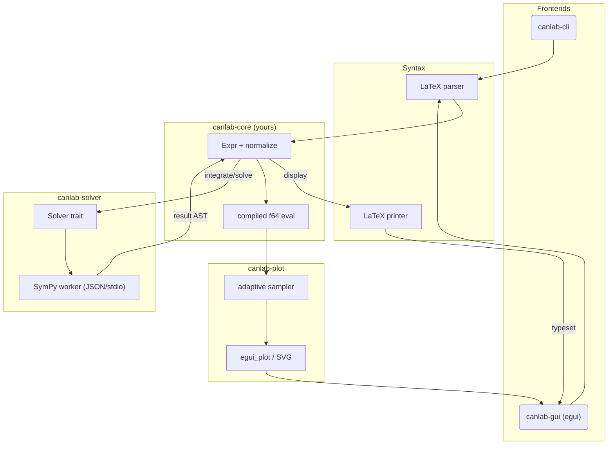

# CanLab — Implementation Plan (v2, decisions locked)

**Project:** LaTeX-native computer algebra system with graphing.
**Stack:** Rust core + egui + external symbolic solver.
**Status:** all phases built, tested and running; see §0 for what actually shipped.

---

## 0. Status: what shipped

The workspace is a working, tested, running application. **366 tests green.**

| Crate | What it does | Tests |
|---|---|---|
| `canlab-core` | `Expr` (Arc, n-ary), exact `i128` rationals, canonicalization, compiled `f64` eval | 28 |
| `canlab-parse` | LaTeX lexer + Pratt parser, Abitti/MathQuill vocabulary | 68 |
| `canlab-tex` | precedence-correct LaTeX printer | 43 |
| `canlab-plot` | adaptive sampler with pole/domain breaks, SVG export | 28 |
| `canlab-solver` | `Solver` trait, hand-written JSON AST, in-memory protocol session, SymPy worker | 61 |
| `canlab-input` | the structural math field: caret in the tree, empty slots, MathQuill key semantics | 75 |
| `canlab-mathview` | layout and painting of the field (fractions, scripts, radicals, carets) | 32 |
| `canlab-gui` | the window: dockable panels, background jobs, dark/light themes | 12 |
| `canlab-cli` | `canlab` binary + REPL, end-to-end tests | 8 |

The build is planned to land in this order, and did: expression core, parser,
printer, plot, solver protocol, structural input, math view, the window on top.

Three deviations from the plan, all forced by the environment:

1. **The network came back.** crates.io *is* reachable from an unsandboxed
   shell, so `egui`/`eframe` 0.37 is real and there is a GUI. The library
   crates still use no third-party dependencies, which was never the point —
   it was a consequence — but it survived by choice: exact arithmetic is
   checked `i128` (degrading to float on overflow) and the solver wire format
   is hand-written JSON.
2. **The field came first, the window second.** MathQuill's behaviour was
   reverse-engineered from `digabi/rich-text-editor` before any pixel was
   drawn, so `canlab-input` and `canlab-mathview` were written against a
   written-down contract, not against whatever the UI happened to need.
3. **No Python,** so the SymPy worker is written but unexercised. What *is*
   tested is the wire format, the protocol session, and the worker's framing,
   driven in memory. `MockSolver` is the default backend and the
   `Solver` trait is the seam.

Still to do: a real backend (SymPy on a machine with Python, or Giac), the
table/environment constructs MathQuill has and this does not (`cases`,
`matrix`, `\lim` with a bound), and a LaTeX → field parser so a history entry
can be clicked back into the editor.

---

## 1. Decision record

| # | Decision | Choice | Consequence |
|---|---|---|---|
| 1 | Symbolic engine | **Hybrid** — Rust owns `Expr`, LaTeX, plotting, eval; external engine does integrate/solve/simplify | Deletes the algebra, calculus and solve modules. Saves ~6 weeks. |
| 2 | Licence | **Hobby project, not shipping** | Giac and Wolfram Engine are unlocked. Pick on technical merit only. |
| 3 | UI | **egui / eframe** | Text editing, `egui_plot`, one codebase, fast compiles. |
| 4 | Platforms | **Windows + macOS/Linux desktop.** No web, no mobile | No `wasm`/no-threads constraints. Python subprocess is available everywhere. |
| 5 | Time | **5–10 h/week** | Milestones cut to 1–3 week chunks, each independently shippable. |

### What decision 1 removes from the original plan

Gone: polynomial arithmetic, GCD, factorization, Hermite reduction, Rothstein–Trager, Risch, Gröbner bases, series, limits, root isolation. All of it is delegated.

Kept: everything that makes the project *yours* — the expression representation, the LaTeX parser and printer, the plotting engine, and the glue that makes an external CAS feel native.

This is the right trade at 5–10 h/week. The parts you keep are the parts a solver cannot give you.

---

## 2. Architecture



### Crates (start with five)

```
cas/
├── Cargo.toml
└── crates/
    ├── canlab-core/     # Expr, Number, normalize, compiled eval   ← start here
    ├── canlab-parse/    # LaTeX + infix parsers
    ├── canlab-tex/      # LaTeX printer
    ├── canlab-solver/   # Solver trait + SymPy worker
    ├── canlab-plot/     # sampling + egui_plot/SVG backends
    └── canlab-gui/      # eframe app  (canlab-cli can live as a bin in canlab-core initially)
```

`canlab-core` depends on nothing but numerics. No GUI, no solver, no parser. Keep it that way — it is what lets you test everything in milliseconds.

---

## 3. The solver protocol — the new linchpin

This is now the most important interface in the project, so design it up front.

### 3.1 The trait

```rust
// canlab-solver/src/lib.rs
pub trait Solver: Send + Sync {
    fn simplify(&self, e: &Expr) -> Result<Expr, SolverError>;
    fn diff(&self, e: &Expr, var: Symbol) -> Result<Expr, SolverError>;
    fn integrate(&self, e: &Expr, var: Symbol) -> Result<Expr, SolverError>;
    fn solve(&self, eq: &Expr, var: Symbol) -> Result<Vec<Expr>, SolverError>;
    fn limit(&self, e: &Expr, var: Symbol, at: &Expr) -> Result<Expr, SolverError>;
    fn series(&self, e: &Expr, var: Symbol, at: &Expr, order: usize) -> Result<Expr, SolverError>;
}

pub enum SolverError {
    NotImplemented,     // the backend declined — show the unevaluated form
    Timeout,
    Backend(String),    // crashed, restarted, retry once
    BadOutput(String),  // protocol violation — a bug on one side or the other
}
```

`SolverError::NotImplemented` is a *normal* result, not a failure. The UI shows the unevaluated `Integral` node and the user moves on. Never let a backend bug become a wrong answer.

### 3.2 The wire format

A small tagged-JSON AST. Basically MathJSON-lite — enough to be lossless for what you need, boring enough to debug by eye.

```json
{"Num": "3/2"}
{"Sym": "x"}
{"Add": [ ... ]}
{"Mul": [ ... ]}
{"Pow": {"base": {...}, "exp": {...}}}
{"Fn": {"name": "sin", "args": [ ... ]}}
{"Integral": {"body": {...}, "var": "x"}}      // unevaluated, round-trips
```

Request/response, one JSON object per line on stdin/stdout:

```json
{"id": 7, "op": "integrate", "expr": {"Pow": {"base": {"Sym":"x"}, "exp": {"Num":"2"}}}, "var": "x"}
{"id": 7, "ok": {"Mul": [{"Num":"1/3"}, {"Pow": {"base": {"Sym":"x"}, "exp": {"Num":"3"}}}]}}
{"id": 7, "err": "timeout"}
```

**Why JSON and not LaTeX?** Because `parse_latex` is experimental, ambiguous on `\sin 2x` and `1/2x`, and silently drops unparseable tails (its own docs admit this). LaTeX is your *display* format, not your wire format. Getting this right on day one avoids a whole class of "the solver misread my input" bugs.

### 3.3 The worker

One long-lived Python process, not one per call — Python startup is ~0.3 s and you'd feel it on every keystroke.

```python
# canlab-solver/python/worker.py
import sys, json, sympy as sp

def build(n):                      # JSON  ->  SymPy
    if "Num" in n: return sp.Rational(n["Num"])
    if "Sym" in n: return sp.Symbol(n["Sym"])
    ...

def dump(e):                       # SymPy ->  JSON
    ...

for line in sys.stdin:             # main loop
    req = json.loads(line)
    try:
        print(json.dumps({"id": req["id"], "ok": dump(handle(req))}), flush=True)
    except Exception as ex:
        print(json.dumps({"id": req["id"], "err": str(ex)}), flush=True)
```

Rust side: spawn once, `BufReader` on stdout, a request-id map, a worker thread. On crash or timeout: kill, respawn, retry the request once, and if it fails again return `Backend`.

**Timeouts are mandatory.** `integrate` on a nasty expression can run for minutes. Wall-clock budget per call (~5 s default, rising to ~30 s if the user asks for it), then kill and restart. A frozen UI is worse than a wrong answer.

**Never `eval()` user input in Python.** Build SymPy trees only from the JSON AST.

### 3.4 Choosing the backend, given licence is a non-issue

| Backend | Install cost | Quality | When |
|---|---|---|---|
| **SymPy** ⭐ start here | `pip install sympy` — 2 minutes | Good; occasionally weird forms | Day one |
| **Giac** | Painful on Windows (`libgiac` + `-lgmp`, MSVC/C++ ABI shim) | Better: faster, fuller, has native `latex()` | If SymPy proves too slow or too limited |
| **Wolfram Engine** | Heavy install + account activation; CLI only | Excellent | When you want a correctness oracle to check SymPy against |

Start on SymPy because friction is your scarcest resource at 5–10 h/week. The trait means switching is a ~200-line file, not a rewrite.

> Because this is a hobby project you may use the free Wolfram Engine for development. Don't build it into the product path — use it to check answers.

---

## 4. Core design (unchanged — this part was right)

### 4.1 Expression type

```rust
pub struct SymbolId(u32);                 // interned names
pub type Expr = std::sync::Arc<ExprNode>; // clone = refcount bump

pub enum ExprNode {
    Num(Number),
    Sym(SymbolId),
    Add(Vec<Expr>),      // n-ary, flattened, sorted, no constant folding here
    Mul(Vec<Expr>),      // n-ary, numeric coefficient hoisted to [0]
    Pow(Expr, Expr),
    Fn(FuncId, Vec<Expr>),
    Hold(Box<Hold>),     // unevaluated Integral / RootOf — still prints as LaTeX
}
```

**Keep raw and smart constructors separate.** `ExprNode::add_raw(...)` does nothing clever; `build::add(...)` normalizes, folds, sorts and merges like terms. Without this split, normalization becomes recursive and quadratic.

`Arc` not `Box`: rewrites share 95% of the old tree, and you get `Send + Sync` free.

### 4.2 Number

```rust
pub enum Number { Int(BigInt), Rat(Rational), Float(OrderedFloat<f64>) }
```

`2` and `2.0` are structurally different and both survive. Exactness is a property of the value; degrading `1/3` to `0.3333` is a bug even when it "looks right". Use `dashu` (MIT/Apache) or `num-rational` — at this scale either is fine; `dashu` if you want the float/complex types later.

### 4.3 Compiled evaluation

Don't walk the tree per sample. Compile once to a flat `Vec<Op>`; the plot inner loop becomes a linear sweep with no pointer chasing.

```rust
pub enum Op { Const(f64), Var(u16), Neg, Add, Sub, Mul, Div, Pow, Sin, Cos, Tan, Ln, Exp, Sqrt, Abs }
pub struct Program { ops: Vec<Op>, n_vars: u16 }
```

It also gives you the plotting semantics for free: `NaN` = outside the domain, `±Inf` = pole, finite-but-huge = near a pole.

### 4.4 LaTeX: write the parser and printer together

The invariant test, written before either module works:

```rust
proptest! {
    fn latex_roundtrip(e in arb_expr()) {
        let c = normalize(e);
        prop_assert_eq!(normalize(parse_latex(&print_latex(&c)).unwrap()), c);
    }
}
```

Every failure is a precedence bug in exactly one of the two, and shrinking shows you which.

Precedence, loosest to tightest: relation → `+ -` → `\cdot \times \div` → **implicit multiplication** → unary minus → `^ _` (right-assoc) → postfix `!`.

Two conventions to fix now and test forever: `1/2x` parses as `1/(2x)`, and `\sin 2x` swallows the next factor. Document both in the README. Reject `\begin{pmatrix}` and unknown commands with a clear error rather than guessing.

### 4.5 Plotting: segments, not points

```rust
pub struct Curve { pub segments: Vec<Vec<[f64; 2]>> }
```

A discontinuity ends a segment, so the renderer never draws the fake vertical line at an asymptote. That single type choice fixes the artifact that plagues most naive plotters.

Sampler: uniform at ~2 samples/pixel, then classify each interval — NaN transition → domain boundary (bisect), sign change with blow-up → pole (bisect, break the segment), high curvature → subdivide. Cap total evaluations around 200k.

Write your own SVG serializer from `Curve` (~200 lines). Perfect vector export, no dependency, deterministic golden tests.

---

## 5. Phases at 5–10 h/week

Each phase ends with something you can actually run.

| Phase | Deliverable | Acceptance | Est. |
|---|---|---|---|
| **0. Bootstrap** | rustup + MSVC build tools, workspace, CI | `cargo test` green on an empty crate | 1 session |
| **1. Expression core** | `Expr`, `Number`, `normalize`, plain-text `Display` | `(x+1)^2` at `x=2` → `9`; normalize idempotent | 2 wk |
| **2. Compiled eval** | `Program::compile` + `eval` | >10M evals/s on a 20-node tree | 1 wk |
| **3. LaTeX printer** | precedence-correct output, golden tests | paste output into a KaTeX demo, it renders | 1–2 wk |
| **4. LaTeX parser** | full MVP subset | round-trip property green; fuzzer clean 1 h | 2–3 wk |
| **5. Solver bridge** | `Solver` trait, JSON AST, SymPy worker | `integrate x^2 dx` → `\frac{x^{3}}{3}` end-to-end | 2 wk |
| **6. Plot engine** | sampler + SVG export | `sin(x)/x` over `-10..10` produces a correct SVG | 2 wk |
| **7. GUI** | eframe: input, typeset result, plot panel, history | type → integrate → plot, without leaving the window | 2–3 wk |
| **8. Polish** | CLI, export PNG/SVG, error states, README | someone else can run it | 1–2 wk |
| | **Total** | | **~14–18 weeks** |

Phases 1–2 are where you'll spend more time than you expect. That's fine — they're load-bearing, and they're pure logic you can test without a window on screen.

**The motivating demo (end of phase 5, ~week 8):** type `\int_0^1 x^2\,dx`, see `\frac{1}{3}` rendered as LaTeX. That one flow touches parser, printer, solver and UI, and it's the thing that keeps you going.

---

## 6. Risks (re-ranked for this scope)

| # | Risk | Mitigation |
|---|---|---|
| 1 | **Solver backend churn** — SymPy output forms change, worker crashes | Wire format is stable JSON; `NotImplemented` is a valid answer; retry-once-then-degrade |
| 2 | **Hangs** — Risch on a nasty integral runs for minutes | Hard timeouts, kill+respawn, never block the UI thread |
| 3 | **LaTeX ambiguity** — `\sin 2x`, `1/2x`, subscripts | Precedence table + explicit tests + fuzz; documented conventions |
| 4 | **Motivation decay at 5–10 h/week** | Every phase ships something runnable; the week-8 demo is the anchor |
| 5 | **Cycle creep** — adding a GUI before the core is solid | Phases 1–5 are headless and fully testable |
| 6 | **Over-fitting to SymPy** | Never let SymPy types leak past the `Solver` boundary |

---

## 7. First session checklist

1. `winget install Rustlang.Rustup`, then "Desktop development with C++" from VS Build Tools, then `rustup default stable`.
2. `pip install sympy` and confirm: `python -c "import sympy; print(sympy.latex(sympy.integrate(sympy.Symbol('x')**2, 'x')))"` → `\frac{x^{3}}{3}`.
3. Create the workspace and `canlab-core`; write `expr.rs` — the enum, `SymbolId`, raw-vs-smart constructors.
4. Write `normalize`'s tests **before** its body.
5. Nothing else. No GUI, no parser, no plot.

---

## Appendix: original reasoning kept for reference

The v1 plan (own CAS, egui, 20 weeks, full Risch/factorization/Gröbner path) is preserved in git history if you ever want to revisit the "build the engine" route. The expression design, LaTeX strategy, compiled-eval decision and plotting segment model carry over unchanged; the algebra/calculus/solve chapters are now delegated.
