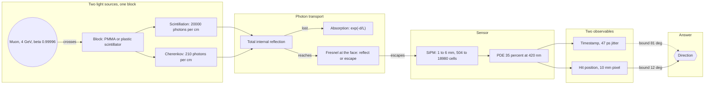
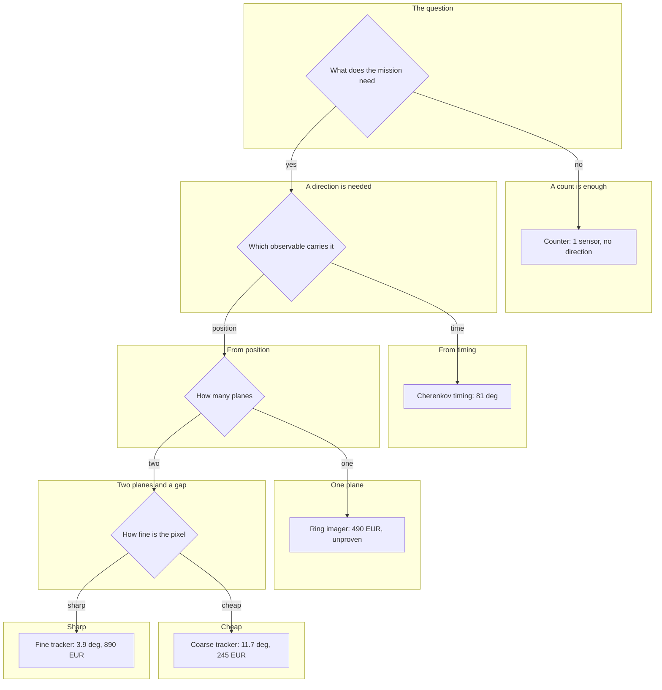

# The muon detector — design study

*Everything the simulation knows about detecting a cosmic muon in a 115 mm × Ø66 mm
can, and the five designs it has been used to compare. The numbers are from
`cargo run --release -p canlab-muon --bin design_study`.*

---

## The headline

**A direction from arrival times is measurable, and the block's sensor placement
wastes it.** Light crosses the 54.1 mm between the two furthest sensors in
**269 ps**, and the readout's jitter is 47.4 ps — a signal-to-noise of 4.7, which
is a measurement. The Cramér–Rao bound on the heading is **81°** at the worst
heading, and the reason it is not the ~17° a well-spread tetrahedron gives is that
the two end sensors sit only **10 mm apart**. Moving them to the block's corners
gives 56° at worst and 16° at best.

**A direction from position is better and simpler.** Two planes separated by a gap
give two crossing points, and two points give a line. A 20 mm pixel over a 40 mm
gap is **11.7°**, and the gap is air inside a can that is 115 mm tall.

**A plastic scintillator gives 95 times the light of a Cherenkov radiator at PMMA's index.** The
same centimetre that emits 270 Cherenkov photons emits 20 000 scintillation
photons. That removes the photon starvation the Cherenkov design fights, and it
changes which sensor is correct: the 1 mm² part with 504 microcells saturates on a
scintillator and is right for a Cherenkov block.

---

## The chain

The dotted edge is the one that does not arrive. A timestamp carries no direction
information because the light does not take long enough to cross the block for the
crossing time to differ between sensors.

---

## The six designs

| Design | EUR | g | Sensors | Angle | Directed muons | Verdict |
|---|---|---|---|---|---|---|
| Counter | 148 | 37.2 | 1 | none | 31.3 | No direction |
| Cherenkov timing (hexagon) | 218 | 73 | 4 | 81.2° bound | 26 | 25.9° network, 62 % within 30° |
| **Short tracker** | **278** | **28.0** | **8** | **(23.4°) formula** | **10.1** | **Passes** |
| Coarse tracker | 278 | 28.0 | 8 | (11.7°) formula | 5.3 | Too few muons |
| Fine tracker | 923 | 28.0 | 32 | (3.9°) formula | 3.1 | Over budget |
| Ring imager | 490 | 22.7 | 16 | (10.6°) estimate | 11.4 | Unproven |

*Directed muons* are the crossings that reach both planes in a 100 s flight — the
sample a direction measurement has to work with.

Only the short tracker passes the mission's audit. It is the recommendation, and
[designs.md](designs.md) is why.

**One caveat that matters more than the table:** the tracker's angle is a
*formula*, not a simulation. No code in this crate generates a tracker hit — there
is no scintillator transport and no pixel model — so 23.4° is the best case for an
idealised detector. The Cherenkov timing design's 81.2° *is* a verified bound.
[designs.md](designs.md) says which is which.

---

## Which design to pick

---

## The documents

| File | What it holds |
|---|---|
| [overview.md](overview.md) | **The current design on one page**: the signal chain, the numbers, the network, and what is uncertain |
| [physics.md](physics.md) | The physics in detail: every equation, every constant, and the worked budgets |
| [simulation.md](simulation.md) | The simulation in detail: every module, every draw, and what is not modelled |
| [cherenkov.md](cherenkov.md) | **The Cherenkov timing design in full**: the physics, the block, the sensors, the readout, the timing, the reconstruction, the cost, and what is open |
| [designs.md](designs.md) | The six designs, their numbers, and the trade each one makes |
| [components.md](components.md) | The four parts, their datasheet numbers, availability, and the jitter budget |
| [constraints.md](constraints.md) | The mission's parameters and requirements, and the audit that enforces them |

---

## A correction this study had to make

The first version of these numbers was wrong by a factor of a thousand. The speed
of light was written as `299.792458 mm/ps`, which is millimetres per **nanosecond**:
light a thousand times too fast, every timing signal a thousand times too small,
and a direction that is measurable at tens of degrees reported as unmeasurable at
eighty thousand.

The tests did not catch it because they asserted the code's own arithmetic —
`signal == 54.1 / 201.2` passes whether 201.2 is millimetres per picosecond or per
nanosecond. `crates/canlab-muon/tests/units.rs` now states every physical fact
**independently** (a metre is 3.34 ns; a nanosecond is a foot; the transport
computes from `c` in metres per second) and asks whether the code agrees.

The lesson is in [lessons.md](../lessons.md): a test that uses the same constant on
both sides of an assertion tests nothing about the constant.

---

## What is not known

1. **The SiPM's SPTR is not in its datasheet.** It is the largest term in the
   jitter budget and the only one with no figure. It needs a measurement.
2. **The ring imager has never been simulated.** Its 10.6° is a geometric estimate
   and is marked as unchecked wherever it appears.
3. **The collection efficiency is an assumption.** 25 % is the middle of what a
   well-made paddle achieves; a real one can be 10 % or 40 %, and that factor
   moves every photoelectron count in this folder.
4. **A machined acrylic face scatters.** The transport's Fresnel reflection assumes
   a mirror, so a CNC-cut block's light yield is an upper bound until a scattering
   model exists.

---

## Se även

- [MUONDETEKTOR.md](../../../can-sat/dokument/MUONDETEKTOR.md) — the mission's own muon document
- [DESIGN.md](../../crates/canlab-muon/DESIGN.md) — the crate's design note
- [status.md](../status.md) — the project's build status
