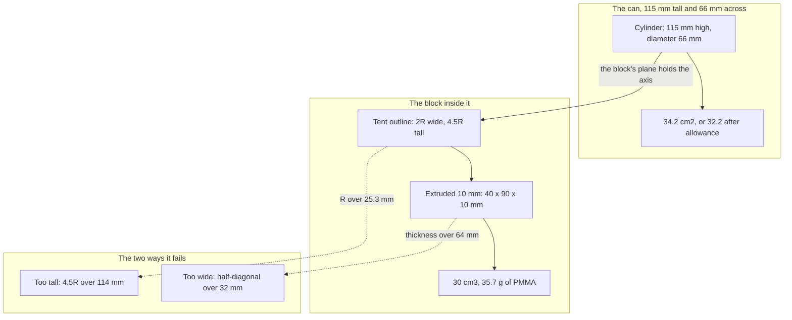

# Five designs and the trade each one makes

*From `cargo run --release -p canlab-muon --bin design_study`. Every number is
computed from the geometry and the parts; cost is an estimate from the documented
module range scaled by area, not a quote.*

---

## The table

| Design | EUR | g | Sensors | pe/plane | Saturates | Angle | Verdict |
|---|---|---|---|---|---|---|---|
| counter | 115 | 48.8 | 1 | 1745 | no | — | no direction |
| cherenkov timing | 185 | 47.7 | 4 | 18 | no | 81 176° | rejected |
| **coarse tracker** | **245** | **44.7** | **8** | **873** | yes | **11.7°** | **passes** |
| fine tracker | 890 | 44.7 | 32 | 873 | yes | 3.9° | over budget |
| ring imager | 490 | 44.7 | 16 | 1745 | yes | (10.6°) | unproven |

`pe/plane` is photoelectrons per muon crossing one plane. `Saturates` is whether
that fills the sensor's microcells — which is **not** automatically bad, and the
next section is why. A number in parentheses is a geometric estimate that no
simulation here has checked.

---

## Design 1 — the counter

**Optimises: cost and reliability.** One scintillator plane, one sensor, no
direction.

The repo's own design, from `MUONDETEKTOR.md` §4: a plastic scintillator plate
about a centimetre thick with a SiPM, counting pulses per second and comparing the
rate at 1 km with the rate on the ground. It is the baseline every other design has
to justify itself against, and it is a good baseline: 1 745 photoelectrons per
muon, a 6 mm sensor with 18 980 cells that does not saturate, and 115 €.

It uses the **largest** sensor of the three, and that is not waste. A counter's
science is a rate *and* a crude energy, so it needs the pulse height, and a pulse
height that fills the sensor is a pulse height that has stopped carrying energy.

**What it cannot do:** a direction. One plane gives one crossing point and one
point is not a line.

---

## Design 2 — Cherenkov timing

**Optimises: the existing parts.** The block, four sensors, a time-to-digital
converter.

This is the design the study started from, and the bound rejects it. The whole
detector's timing signal is 0.22 ps and the readout's jitter is 47.4 ps, so the
heading's uncertainty is 81 176°.

It is also the **most expensive way to learn nothing**: 185 € for four sensors and
a timer, against 115 € for a counter that at least counts.

The photon count is the other half of the problem. A Cherenkov radiator gives 21
photons per millimetre at n = 1.49, so a 10 mm path gives 210 photons and, after
25 % collection and 35 % PDE, **18 photoelectrons** — against the scintillator's
1 745. The Cherenkov design is photon-starved and the scintillator is not, and the
factor is 74.

---

## Design 3 — the coarse tracker

**Optimises: the cheapest two-axis direction.** Two planes of 2 × 2 pixels, a 40 mm
gap, eight sensors. **245 €, 11.7°, and the only design that passes the audit.**

The resolution is `√2·σ_h/L`: a 20 mm pixel has `σ_h = 20/√12 = 5.77 mm`, and over
a 40 mm gap that is `√2 × 5.77/40 = 0.204 rad = 11.7°`.

Two things make it work:

- **The gap is free.** It is air inside a can that is 115 mm tall, and a longer gap
  is a better detector at no cost. The fine tracker's 60 mm gap is why it reaches
  3.9°.
- **Saturation does not matter.** A tracker reads out *which* pixel fired, so a
  clipped pulse is still a hit. That is what lets it use the 1 mm² part at 25 €
  instead of the 3 mm² at 45 €, and it is the difference between 245 € and 405 €.

**What it cannot do:** better than 11.7° without more pixels, and 11.7° is coarse.
A muon arriving from 20° and one from 30° land in the same bin.

---

## Design 4 — the fine tracker

**Optimises: the best direction money can buy.** Two planes of 4 × 4 pixels, a
60 mm gap, thirty-two sensors. **890 €, 3.9°.**

Three times the budget for three times the resolution, and it is over the
detector's 200–300 € allocation by a factor of three. It is in the table because a
trade study that only lists the affordable options is not a trade study: the
question "what would 3.9° cost" has an answer, and the answer is 890 €.

The cost is entirely the sensors — 32 × 25 € is 800 € of the 890 €. A multiplexed
readout would cut it, at the price of not knowing which pixel fired without a
coincidence, which is the same information the tracker exists to provide.

---

## Design 5 — the ring imager

**Optimises: direction from one face.** A Cherenkov block with a 4 × 4 sensor array
on its exit face. **490 €, (10.6°), unproven.**

A muon crossing the block emits a cone at 47.8°, and where the cone meets the exit
face is a ring. The ring's radius gives the angle and its centre gives where the
muon left, so one face and one array give a direction with no gap and no second
plane.

**It has never been simulated.** The transport traces a photon to a face and
reports *which* face, not *where* on it, so the ring's radius is not something the
current code can measure. The 10.6° in the table is `pixel/ring_radius` — a
geometric estimate — and it is marked unchecked wherever it appears.

It is listed because the idea is worth checking and because leaving it out would
imply the space is closed. It is not a recommendation.

---

## Why the tracker and not the timer

The two designs differ in which observable they read, and the difference is not a
matter of degree.

| | Timing | Position |
|---|---|---|
| What is measured | when the light arrived | where it crossed |
| Lever arm | 0.22 ps across the whole block | 40 mm between planes |
| Readout jitter | 47.4 ps | 5.8 mm of pixel |
| Signal-to-noise | 0.005 | 7 |
| Bound | 81 176° | 11.7° |

The timing design's signal-to-noise is 0.005: the thing being measured is two
hundred times smaller than the noise measuring it. The position design's is 7: the
pixel is seven times smaller than the gap. That is the whole comparison, and no
amount of electronic care moves the first column.

---

## The can

Every design has to fit a cylinder, and the block is the only one whose shape is
constrained by it.

The geometry sweep's best row is a 30 mm tent, which is `4.5 × 30 = 135 mm` of
block in a 115 mm can. The sweep reported it as the best geometry and never asked
whether it fits; `Can::admits` refuses it by name and `Mission::audit` reports it.

A tracker's planes are boxes and fit more easily: 40 × 80 × 5 mm each, two of them,
with 40 mm of air between. The pair is 50 mm tall inside a 114 mm can, so the gap
could be twice as long — which is the cheapest improvement available.

---

## The recommendation

**Build the coarse tracker, and lengthen the gap.**

It is the only design that passes the audit at 245 €, it measures two axes at 11.7°,
and its resolution is bought with a gap that costs nothing. Doubling the gap to
80 mm would take it to 5.9° for the price of nothing but height, and the can has
the height.

The counter remains the fallback if the direction mission is dropped: it is cheaper,
simpler, and its science — a rate against altitude — is the one the mission
documents were written around.

---

## Se även

- [README.md](README.md) — the overview and the headline
- [simulation.md](simulation.md) — how the numbers are produced
- [components.md](components.md) — the parts and their availability
- [constraints.md](constraints.md) — the requirements the audit enforces
