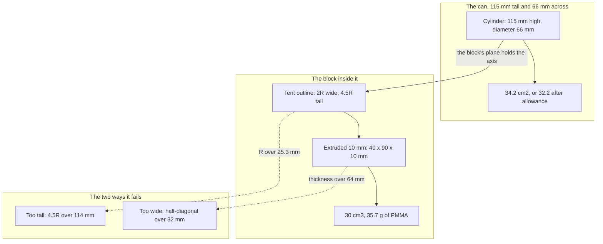

# Five designs and the trade each one makes

*From `cargo run --release -p canlab-muon --bin design_study`. Every number is
computed from the geometry and the parts; cost is an estimate from the documented
module range scaled by area, not a quote.*

---

## The table

| Design | EUR | g | Sensors | Angle | Crossings | Directed | Verdict |
|---|---|---|---|---|---|---|---|
| counter | 115 | 44.9 | 1 | — | 40.9 | 40.9 | no direction |
| cherenkov timing | 185 | 47.7 | 4 | 81.2° | 11.4 | 11.4 | fails at 30° |
| **short tracker** | **245** | **31.6** | **8** | **23.4°** | **24.4** | **13.3** | **passes** |
| coarse tracker | 245 | 31.6 | 8 | 11.7° | 24.4 | 7.3 | too few muons |
| fine tracker | 890 | 31.6 | 32 | 3.9° | 24.4 | 4.4 | over budget |
| ring imager | 490 | 22.7 | 16 | (10.6°) | 11.4 | 11.4 | unproven |

**Crossings** are muons through the first plane in a 100 s flight. **Directed** are
the ones that cross *both* planes and therefore have a direction — the crossings
times the coincidence acceptance. The two columns are the same for a single-plane
design, and they are the difference between a counter and a tracker.

Photoelectrons per muon: 1 745 for a scintillator plane, 19 for the Cherenkov
block (measured by the transport, not modelled).

### Where the angles come from

**Only one of these numbers is a measurement of anything, and it is the one that
says the design fails.**

| Angle | Kind | What that means |
|---|---|---|
| 81.2° (Cherenkov timing) | **bound** | A Cramér–Rao limit from the Fisher information of four timestamps, checked against a Monte Carlo of the least-squares estimator that attains it |
| (23.4°), (11.7°), (3.9°) (trackers) | **formula** | `√2·σ_h/L` with `σ_h = pixel/√12`. The algebra is right for its model and the model has been checked against a Monte Carlo of *two Gaussian points* — but **no simulation generates a tracker hit** |
| (10.6°) (ring imager) | **estimate** | A pixel over a lever arm, with no validation at all |

The tracker's number assumes each hit is localised to one pixel with uniform
uncertainty, that the two hits are independent, and that nothing scatters. None of
those has been simulated. A real tracker simulation would need a scintillator
model — light yield, transport to the pixel array, light sharing between pixels —
and a hit reconstruction, and neither exists in this crate.

So the tracker's 23° is **the best case for an idealised detector**, and the honest
reading of the table is: the tracker's physics is unmodelled and its number is
optimistic; the timing design's physics *is* modelled and its number is a
verified limit. That asymmetry is why the recommendation needs a simulation behind
it before it is trusted.

---

## The dimensions

Every design has to fit a cylinder, and the cylinder is what decides the planes'
size before any physics does.

```mermaid
flowchart TB
    subgraph G_CAN["Can: 115 mm tall, 66 mm across"]
        TOP["Lid and parachute: 45 mm above"]
        STACK["Two planes and a gap"]
        ROOM["64 mm left for battery and radio"]
    end
    subgraph G_STACK["Tracker stack: 50 of 114 mm"]
        P1["Plane 1: 40 x 48 x 5, 2 x 2 pixels"]
        GAP["Gap: 20 or 40 mm of air"]
        P2["Plane 2: the same, in coincidence"]
    end
    subgraph G_WHY["Why 40 x 48 and not 40 x 80"]
        DIAG["40 x 80 has an 89 mm diagonal"]
        LIMIT["64 mm circle: 40 mm plane, 48 mm tall"]
    end
    TOP --> STACK
    STACK --> ROOM
    P1 -->|"a muon crosses both"| GAP
    GAP --> P2
    DIAG -.->|"does not fit"| LIMIT
```

| Design | Shape | Plane, mm | Area, cm² | Stack, mm | Fits |
|---|---|---|---|---|---|
| counter | disc | Ø64 × 10 | 32.2 | 10 | yes |
| cherenkov timing | tent prism | 40 × 90 × 10 | 9.0 (wall) | 10 | yes |
| short tracker | rectangle | 40 × 48 × 5 | 19.2 | 30 | yes |
| coarse tracker | rectangle | 40 × 48 × 5 | 19.2 | 50 | yes |
| fine tracker | rectangle | 40 × 48 × 5 | 19.2 | 70 | yes |
| ring imager | tent prism | 40 × 90 × 10 | 9.0 (wall) | 10 | yes |

Three numbers in that table are worth explaining.

**The planes are 40 × 48 mm, not 40 × 80.** A rectangle fits a Ø64 mm circle only
if its diagonal does, and 40 × 80 has an 89 mm diagonal. The widest 40 mm plane is
48 mm tall — 62.5 mm of diagonal, with 1.5 mm to spare. The first version of this
study used 40 × 80 and never checked.

**The counter is a disc.** The square inscribed in a Ø64 circle is 45.3 mm on a
side, 20.5 cm²; the disc is 32.2 cm², 57 % more light for the same can. A counter
has no reason to be square.

**The Cherenkov block is on edge.** Its tent plane is 40 mm across and 90 mm tall,
which cannot lie flat in a 64 mm circle — but it does not have to, because the
block's plane can hold the can's axis. The circle then constrains the 40 × 10
cross-section (20.6 mm of half-diagonal against 32 mm of radius) and the height
constrains the 90 mm. The muon crosses the walls, so the face it enters is
90 × 10 mm and the material it crosses is 40 mm.

---

## Design 1 — the counter

**Optimises: cost and reliability.** One scintillator plane, one sensor, no
direction.

The repo's own design, from `MUONDETEKTOR.md` §4: a plastic scintillator plate
about a centimetre thick with a SiPM, counting pulses per second and comparing the
rate at 1 km with the rate on the ground. It is the baseline every other design has
to justify itself against, and it is a good baseline: 1 745 photoelectrons per
muon, a 6 mm sensor with 18 980 cells that does not saturate, and 115 €.

It uses the **largest** sensor of the three, and that is not waste. A counter's
science is a rate *and* a crude energy, so it needs the pulse height, and a pulse
height that fills the sensor is a pulse height that has stopped carrying energy.

Its plate is a **Ø64 mm disc**, 10 mm thick, mounted across the can's axis: 32.2 cm²
and 40.9 muons in a 100 s flight. That is **three times the sample** a two-plane
tracker gets, because a counter needs no coincidence and a disc uses the whole
circle.

**What it cannot do:** a direction. One plane gives one crossing point and one
point is not a line.

---

## Design 2 — Cherenkov timing

**Optimises: the existing parts.** The block, four sensors, a time-to-digital
converter.

This is the design the study started from, and it fails the 30° direction
requirement at **81.2°** — but not for the reason the first version of this study
gave. Light crosses the 54.1 mm between the two furthest sensors in **269 ps**,
against 47.4 ps of jitter: a signal-to-noise of 4.7, which is a measurement. The
failure is the **sensor placement**, not the clock.

The two end sensors sit at the centres of the block's `±z` faces, which are
**10 mm apart** — the block's thickness. A heading along that axis therefore has
almost no lever arm, and the worst-case bound is governed by it. The same block
with the four sensors on its corners gives 56° at worst and **16° at best**, and a
well-spread 54 mm tetrahedron gives 17.5°.

So the honest verdict is: timing works, this placement does not. It is still not
the recommendation, because a tracker reaches 11.7° with no timer and no
picosecond electronics at all.

The photon count is the other half of the problem. The transport measures **8
photoelectrons** per muon for the Cherenkov block — not the 18 that a
born-times-collection estimate gives, because 52 % of the light is trapped by
total internal reflection and much of the rest leaves through a face no sensor
covers. Against the scintillator's 1 745, the Cherenkov design is photon-starved
by a factor of 95 at PMMA's index.

---

## Design 3 — the short tracker

**Optimises: the sample.** Two planes of 2 × 2 pixels, a **20 mm** gap, eight
sensors. **245 €, 23.4°, 13.3 muons — and the only design that passes the audit.**

This design exists because of a question the first version of the table could not
answer: *does the tracker catch enough muons?* It did not, and the answer is the
coincidence acceptance.

A muon entering the first plane at some angle drifts sideways before it reaches
the second. A muon at 30° drifts `40 × tan 30° = 23 mm` over a 40 mm gap, which is
most of the plane's 40 mm width — so it misses. Averaged over the sea-level
`cos²θ` flux, a 40 mm gap keeps **30 %** of the crossings and a 20 mm gap keeps
**54 %**.

The gap is also what buys the angle, so the two are one trade:

| Gap | Acceptance | Directed muons | Angle |
|---|---|---|---|
| 20 mm | 0.54 | 13.3 | 23.4° |
| 40 mm | 0.30 | 7.3 | 11.7° |
| 60 mm | 0.18 | 4.4 | 3.9° |

Halving the gap doubles the sample and doubles the angle. The short tracker is the
20 mm end, and it is the recommendation because **seven muons is not a
distribution** — the coarse tracker's 11.7° is better per event and worse per
flight.

---

## Design 4 — the coarse tracker

**Optimises: the angle per event.** Two planes of 2 × 2 pixels, a 40 mm gap, eight
sensors. **245 €, 11.7°, and 7.3 muons — too few to pass.**

The resolution is `√2·σ_h/L`: a 20 mm pixel has `σ_h = 20/√12 = 5.77 mm`, and over
a 40 mm gap that is `√2 × 5.77/40 = 0.204 rad = 11.7°`.

Two things make it work:

- **The gap is free.** It is air inside a can that is 115 mm tall, and a longer gap
  is a better detector at no cost. The fine tracker's 60 mm gap is why it reaches
  3.9°.
- **Saturation does not matter.** A tracker reads out *which* pixel fired, so a
  clipped pulse is still a hit. That is what lets it use the 1 mm² part at 25 €
  instead of the 3 mm² at 45 €, and it is the difference between 245 € and 405 €.

**What it cannot do:** gather a sample. Seven muons in a flight is enough to
demonstrate that the technique works and not enough to measure an angular
distribution, and the distribution is the science. The audit fails it on exactly
that.

---

## Design 5 — the fine tracker

**Optimises: the best direction money can buy.** Two planes of 4 × 4 pixels, a
60 mm gap, thirty-two sensors. **890 €, 3.9°.**

Three times the budget for three times the resolution, and it is over the
detector's 200–300 € allocation by a factor of three. It is in the table because a
trade study that only lists the affordable options is not a trade study: the
question "what would 3.9° cost" has an answer, and the answer is 890 €.

The cost is entirely the sensors — 32 × 25 € is 800 € of the 890 €. A multiplexed
readout would cut it, at the price of not knowing which pixel fired without a
coincidence, which is the same information the tracker exists to provide.

---

## Design 6 — the ring imager

**Optimises: direction from one face.** A Cherenkov block with a 4 × 4 sensor array
on its exit face. **490 €, (10.6°), unproven.**

A muon crossing the block emits a cone at 47.8°, and where the cone meets the exit
face is a ring. The ring's radius gives the angle and its centre gives where the
muon left, so one face and one array give a direction with no gap and no second
plane.

**It has never been simulated.** The transport traces a photon to a face and
reports *which* face, not *where* on it, so the ring's radius is not something the
current code can measure. The 10.6° in the table is `pixel/ring_radius` — a
geometric estimate — and it is marked unchecked wherever it appears.

**And it has 8 photoelectrons per muon.** A ring needs tens of photons to have a
shape; eight is a handful of dots. The design is listed because the idea is worth
checking, not because the light is there — and the light is the first thing to
check.

It is listed because the idea is worth checking and because leaving it out would
imply the space is closed. It is not a recommendation.

---

## Why the tracker and not the timer

The two designs differ in which observable they read, and the difference is not a
matter of degree.

| | Timing | Position |
|---|---|---|
| What is measured | when the light arrived | where it crossed |
| Lever arm | 269 ps across the whole block | 40 mm between planes |
| Readout jitter | 47.4 ps | 5.8 mm of pixel |
| Signal-to-noise | 5.7 | 7 |
| Bound, this placement | 81° | 11.7° |
| Bound, a good placement | 16° | 11.7° |

The two observables are **comparable in signal-to-noise** — 5.7 against 7 — and
that is the correction this study had to make. Timing is not hopeless; it is
merely harder, because its resolution depends on where the sensors sit and its
readout is a picosecond timer, while a tracker's resolution depends on a gap of
air and its readout is a coincidence.

The tracker wins on cost and simplicity, not on physics.

---

## The can

Every design has to fit a cylinder, and the block is the only one whose shape is
constrained by it.

The geometry sweep's best row is a 30 mm tent, which is `4.5 × 30 = 135 mm` of
block in a 115 mm can. The sweep reported it as the best geometry and never asked
whether it fits; `Can::admits` refuses it by name and `Mission::audit` reports it.

A tracker's planes are boxes and fit more easily: 40 × 80 × 5 mm each, two of them,
with 40 mm of air between. The pair is 50 mm tall inside a 114 mm can, so the gap
could be twice as long — which is the cheapest improvement available.

---

## The recommendation

**Build the short tracker — 20 mm gap, 23.4°, 13.3 muons — and simulate it before
trusting the number.**

It is the only design that passes the audit at 245 €. The trade it makes is the one
the table exists to show: halving the gap from 40 mm doubles the sample and doubles
the angle, and thirteen muons at 23° is a better science instrument than seven at
12°, because seven is not a distribution.

**But its angle is a formula, not a simulation.** That is the study's largest
remaining gap, and it is a gap in the *recommended* design rather than in the
rejected one:

| What is missing | Why it decides the answer |
|---|---|
| A scintillator transport | The 873 photoelectrons per plane is `yield × collection × PDE`; total internal reflection, wrapping and light sharing are not modelled |
| A pixel model | The hit is assumed localised to one pixel with uniform uncertainty; a real plane spreads light between neighbours |
| A reconstruction | 23.4° is `√2·σ_h/L`; an actual fit over a real pixel pattern has not been run |
| Multiple scattering | A muon deflects in the planes, which sets a floor on the angular resolution |

Until those exist, 23.4° is the best case for an idealised detector. The Cherenkov
timing design's 81.2° is the *worse* number and the more trustworthy one, because
the transport behind it is real and the bound is verified.

The counter remains the fallback if the direction mission is dropped: it is cheaper,
simpler, catches three times the muons, and its science — a rate against altitude —
is the one the mission documents were written around.

---

## Se även

- [README.md](README.md) — the overview and the headline
- [simulation.md](simulation.md) — how the numbers are produced
- [components.md](components.md) — the parts and their availability
- [constraints.md](constraints.md) — the requirements the audit enforces
