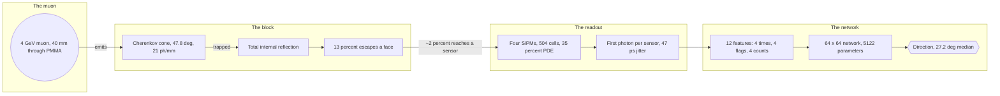

# The muon detector — current design

*A one-page overview of where the design stands: what it is, what it measures, how
well, and what is still uncertain. The full reasoning is in
[DESIGN.md](../../crates/canlab-muon/DESIGN.md); the physics is in
[physics.md](physics.md).*

---

## The design in one paragraph

A **PMMA tent prism**, 40 mm wide, 90 mm tall and 10 mm deep, sits on edge inside
the can. A muon crossing it emits Cherenkov light along a cone at 47.8°. Four
1 mm² SiPMs on four of the block's faces record the **first photon** each one sees,
and a time-to-digital converter timestamps them. Twelve numbers per event — four
times, four "did it fire" flags and four photon counts — go into a small neural
network, which returns the muon's direction.

**The measured resolution is 27.2° median (35.8° at the 68th percentile).**

---

## The signal chain



The number that decides everything is on the arrow from the block to the sensors:
**about 2 % of the light reaches a sensor**. Two losses do it — 87 % of the light
arriving at a PMMA/air face is trapped by total internal reflection, and the
sensors cover 15 % of the faces they sit on.

---

## The numbers

| Quantity | Value | Where |
|---|---|---|
| Block | 40 × 90 × 10 mm tent prism, PMMA, n = 1.491 | `Tropical::fits_in(20, 10)` |
| Block mass | 35.7 g | `tent_mass_g` |
| Cherenkov yield | 21 photons/mm, 840 per crossing | `photons_per_mm(1.0, 1.49)` |
| Photons detected | ~19 per muon from a 40 mm crossing, after TIR, Fresnel and coverage | `detector::simulate` |
| Sensors | 4 × MICROFC-10035, 504 microcells, 35 % PDE | `components` |
| Readout jitter | 47.4 ps total (42.5 SiPM, 20 timer, 6 amp, 2 comparator) | `components::total_jitter_ps` |
| Timestamps per event | 3.25 of 4 on average; 44 % of events have all four | `timing_study::run` |
| Timing signal | 224 ps across the detector | `timing_signal_ps` |
| **Direction resolution** | **27.2° median, 35.8° at 68 %** | `train_timing` |
| Cost | 218 € | `Design::cherenkov_timing` |

---

## How the direction is recovered

The network is a **regressor**, not a classifier: it outputs two continuous numbers
`(dx, dy)`, the horizontal components of the direction, with the vertical one
recovered from the unit constraint. The loss is mean squared error, so it converges
to the conditional mean `E[direction | features]`.

The reported 27.2° is therefore the **median angular error of that point estimate**
over held-out events — the irreducible spread of the true direction around its own
conditional mean. Half the muons are reconstructed to better than 27.2°, and the
**realistic readout** (a threshold, dark counts, crosstalk and walk) keeps **56 %**
of events within the mission's 30°.

| Configuration | Median | 68th percentile |
|---|---|---|
| timestamps only (8 features) | 29.9° | 38.4° |
| **timestamps and counts (16 features)** | **27.2°** | **35.8°** |
| randomised detector | 27.8° | 36.1° |

The four extra features are the **second arrival** at each sensor — the stop a
multi-hit TDC records and a single-threshold readout throws away. The gap between
the first and second photon depends on how far the track is from the sensor, which
is the latent variable the direction fit needs.

### Why the network beats the algebra

Two analytic reconstructions were tried first, and both are worse:

| Method | Median error | Why |
|---|---|---|
| Linear fit, `t = t₀ + (r·d)/v` | 119.5° | The model is wrong: the light does not leave from a point |
| Cherenkov model, **true** track point | 81.1° | The model is right, but four timestamps cannot determine the track position |
| **Network** | **27.2°** | Learns `p(direction \| features)`, marginalising over the track position |

The network is not doing better physics. It is doing something the analytic
inversion cannot: the track position is a **latent variable**, and the network
absorbs it into the conditional distribution. The ablation shows where the
information comes from — the photon counts depend on the path length, and the path
length depends on where the track is, so the counts are worth **2.6°** on their own.
That is less than the earlier study reported, and the difference is a bug fix: the
photon count used to be taken from the caller's 200 mm path instead of the block's
own chord, which credited the block with six times the light it makes.

---

## The block

```text
                 (0, 3)                  the apex
              /         \
     (-1, 1.5)           (1, 1.5)        the shoulders
        |                  |
     (-1,-1.5)           (1,-1.5)        the base
```

A tent, not a slab, because that is what you can cut and still keep a
total-internal-reflection cavity with a flat face for the sensor. With a CNC
available the outline is any closed 2.5D shape within the tool's reach, so the tent
is a choice the study should sweep rather than a manufacturing limit.

The block is mounted **on edge**: its 40 × 90 mm silhouette cannot lie flat in the
can's 56 mm inner circle, but with the tent's plane holding the can's axis the
circle only constrains the 40 × 10 mm cross-section (20.6 mm of half-diagonal
against 28 mm of radius).

---

## The parts

| Part | Role | Key number |
|---|---|---|
| onsemi MICROFC-10035 | SiPM, 1 mm² | 504 microcells, PDE 31–41 %, **SPTR not specified** |
| TI OPA858 | transimpedance amplifier | 5.5 GHz, 2.5 nV/√Hz |
| ADI MAX40026 | comparator | 280 ps delay, 2 ps jitter, 25 ps overdrive dispersion |
| ADI MAX35101 | "analog pulse timer" | 20 ps accuracy, 3.8 ps resolution, **2 channels, no external START** |
| Norland NOA 68 | optical adhesive | cured n = 1.54, €32.70 |

**The MAX35101 is the wrong part for four independent SiPMs.** Its START is
generated internally by its own pulse launcher, so it measures launch-to-echo
rather than "when did this SiPM fire", and its 20 ps is a *differential* accuracy.
A general-purpose TDC with an external START is the replacement.

**Optical adhesive nearly doubles the light.** At a PMMA/air face only 13 % of the
light escapes and an adhesive with an index above PMMA's removes the critical angle
entirely — but the trapped light was not lost, it bounced to another face, so the
transport measures a **1.9× gain** (19.19 → 37.05 detected photons), not the 7.7×
the escape-cone arithmetic suggests.

It also **makes a high-index block viable**: bonding takes it from 7.50 to 32.66
detected photons, a 4.4× gain that closes a 2.6× gap to 1.1×. PMMA still wins
slightly, and it is cheaper and lighter.

The curing is the real risk: PMMA absorbs at the adhesive's 365 nm curing
wavelength, so it has to be cured from the bond line's edge with a 395–405 nm LED.

---

## What is simulated, and what is not

The simulation is `canlab-muon`, separate from the CAS, which is used only to draw
results.

**Modelled:** the Cherenkov yield, total internal reflection,
Fresnel reflection, absorption, the sensors' coverage and PDE, Poisson statistics,
the readout jitter, the coincidence, and the network's training.

**Not modelled:** a PDE curve (one mid-band 35 % is used), the SiPM's SPTR (the
vendor does not specify it; 100 ps FWHM is a placeholder), crosstalk (7 %), dark
counts (30–96 kHz), the breakdown voltage's temperature drift (21.5 mV/°C), surface
scattering from the machined faces, and the comparator's time walk.

The omissions do not all point the same way, which is why they are listed rather
than corrected for.

---

## What is still uncertain

1. **The SiPM's SPTR is not in its datasheet.** It is the largest term in the
   jitter budget and the only one with no figure. It needs a measurement.
2. **The tracker's light model is a kernel, not a transport.** It gives the
   expected photoelectrons per pixel and draws the Poisson count; it does not trace
   individual photons.
3. **The network's 27.2° is a simulation result.** The sim-to-real gap is
   unmeasured, and the domain randomisation only covers the parameters that were
   varied.
4. **The timer part is wrong.** The MAX35101 cannot timestamp four independent
   pulses.
5. **The adhesive's cure is unproven on this geometry.** It needs a trial on scrap
   acrylic.

---

## Se även

- [DESIGN.md](../../crates/canlab-muon/DESIGN.md) — the full design document
- [physics.md](physics.md) — every equation and constant
- [components.md](components.md) — the parts, the adhesive, and multiplexing
- [simulation.md](simulation.md) — how the simulation is built
- [designs.md](designs.md) — the six designs compared
- [constraints.md](constraints.md) — the mission's requirements
