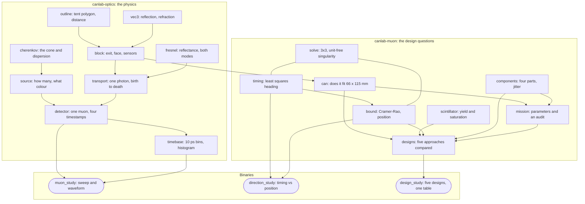
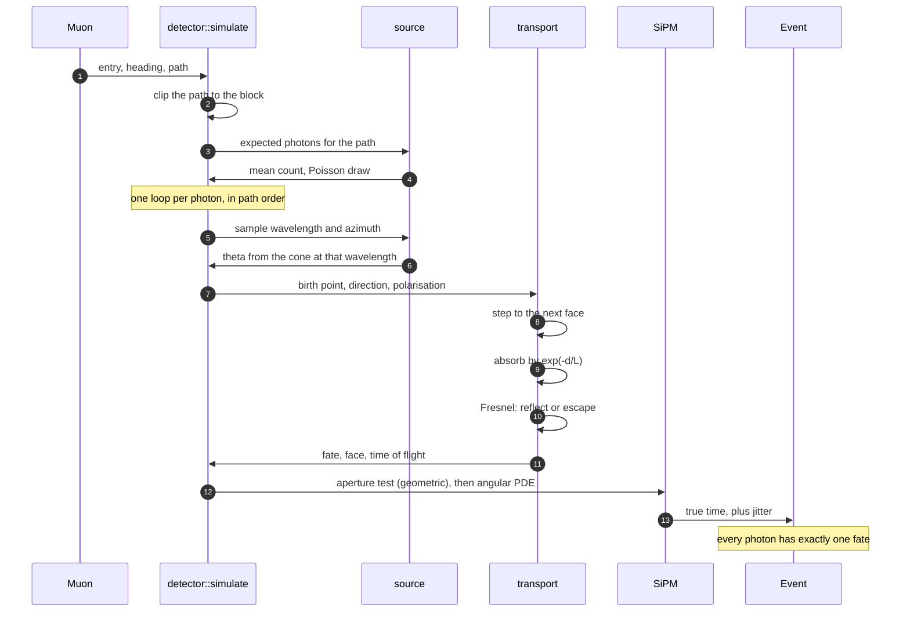

# The simulation, in detail

*What `canlab-optics` and `canlab-muon` compute, in the order they compute it,
with the number each step produces and the ones it does not.*

---

## The two crates

The physics is one crate and the design questions are another. The split is not
tidiness: the physics has a validation suite against closed forms and a fixture
that a second implementation is checked against, and the design questions change
every time a part changes. Mixing them would make every design iteration a change
to the validated code.



---

## One event, step by step

`detector::simulate` is the whole of one muon. It takes an entry point, a heading,
a path length and a random stream, and returns four sorted lists of arrival times.



### 1. The path is clipped to the block

A caller hands a path that usually starts outside the block and ends outside it.
Only the part inside the material makes light, so the path is clipped to the
block's intersection with the line. A block is convex, so that intersection is one
stretch and the clip is exact rather than a search.

*The bug this prevents:* walking the path forwards to find its end is only right
when the start is outside. A muon that entered the block and left it exited at the
first sample, which is at once, and every event reported zero photons.

### 2. The photon count is a Poisson draw

`source::expected_photons` gives the mean from the Cherenkov law,
`dN/dx = 2π α (1 − 1/(β²n²)) ∫dλ/λ²`, which for β ≈ 1 and n = 1.84 over 400–600 nm
is 26.9 photons per millimetre. The count is drawn from a Poisson with that mean,
then clamped to the smallest microcell count among the four sensors.

*The length is the chord, not the caller's path.* The mean is computed from the
length the path has **inside the block**, after the clip — not from the `path_mm`
the caller handed in. A caller that passes a 200 mm path from outside the block to
beyond it would otherwise credit a 10 mm-thick block with the light of a 200 mm
one, which is a factor of twenty. This was a real bug: the timing study passed
200 mm and the count was six times the chord's.

*The Poisson is sampled in log space.* The textbook product-of-uniforms method
compares the running product with `e^{−μ}`, and `e^{−μ}` underflows to zero at
μ ≈ 709. A long path would then be capped at ~709 photons instead of sampling its
mean. Summing `ln(u)` and comparing with `−μ` does not underflow, and it is the
same distribution.

A scintillator does not go through this path: it is not a Cherenkov radiator, and
the transport's source is the Cherenkov law. `canlab_muon::scintillator` carries
the scintillation yield as a separate model, and no event simulation uses it yet.

### 3. Each photon is born on the cone

The wavelength is drawn from the `1/λ²` spectrum by inverting its CDF — one
divide, no rejection. The cone angle comes from `cos θ = 1/(βn)` at the **block's
index**, so the cone is one angle and the dispersion over the band (~0.3°) is not
modelled. The azimuth is uniform.

*The bug this replaced:* the cone was computed from the high-index plastic's
dispersion curve whatever the block was, so a PMMA block emitted at 57.1° instead
of 47.8° — 9.3° wide, which is a different detector. `Photon::sample` now takes
the index, and `cone_angle_at` is the function the simulation uses.

### 4. The photon is traced

`transport::trace` steps to the next face, absorbs by `exp(−d/L)`, and at the face
either reflects or escapes by a Fresnel draw. A photon that reflects is nudged
0.01 mm back inside along the face normal, and the next exit is asked for with the
face it just left excluded.

*The two bugs this prevents:* without the face filter a photon at normal incidence
bounces on one square nanometre of the same face until its budget runs out; and a
nudge along the *new heading* at normal incidence points straight back out, so the
photon lands outside the block it is inside.

The flight time is `Σ dᵢ·nᵢ/c` in the block and `d/c` in air. The path and the
displacement are both reported, because a photon that bounced twice arrives along a
straight line having travelled further, and the difference is the difference
between `t = L·n/c` and the answer a timing measurement gives.

### 5. The sensor decides

The aperture test is **not a draw**. The taper's mouth is a square of
`sensor area × gain` centred on the face — 11.8 mm on the side for the 6 × 6 mm
part — and a photon that hits it crosses, whatever its angle; one that misses it
reflects off the bare PMMA and gets another chance. *Where the photon and the
sensor are* decides the detection, not a random number. The earlier model drew
the photon against the face's mean coverage, which is why a detection could sit
tens of millimetres from the sensor.

What *is* a draw is the conversion: the sensor's PDE at the angle it sees, times
the bond's transmission (0.95 for NOA 68, whose TDS admits voids and unwetted
patches), and then the jitter (a Box–Muller normal with σ = the sensor's
`jitter_ps`).

The PDE is angle-dependent. The measured intrinsic response (Otte et al.,
arXiv:1606.05186, §3.8) is flat to 60° and about 80 % there for S polarisation,
then falls; the model interpolates that in `cos θ` **in the sensor's medium**. A
potted taper keeps the light in the adhesive (n = 1.54), so the angle at the
silicon never exceeds 40° and the PDE stays within 10 % of its normal-incidence
value. A bare sensor refracts into air, where the angle runs to 90° and the PDE
falls to zero — which is why the bare 6 × 6 mm part measures 2.5 photons and the
potted one 10.2.

The aperture is the term that dominates. Leaving it out is how the first version
of the study reported tens of photons per sensor where the geometry allows a
handful.

### 6. Every photon has exactly one fate

`lost + trapped + absorbed + missed + detected == photons_born`. A photon that is
unaccounted for is a bug in a test, not a rounding difference, and the identity is
asserted rather than trusted.

---

## The numbers one event produces

For the design block — a 20 mm tent, 10 mm deep, PMMA, four sensors, a muon across
the walls — averaged over 200 events:

| Quantity | Value |
|---|---|
| Cherenkov photons born | ~210 |
| Arrival-time spread within one sensor | ~18 ps |
| Timing difference between the furthest sensors | ~224 ps |
| Muons through the plane in a 100 s flight | ~31–46 |

The light budget — how many of those photons reach a sensor — is in
[cherenkov.md](cherenkov.md) §4: **10.2 photons per muon and 2.27 sensors timed**
for the design point, the hexagon at 30 mm with the 6 × 6 mm part behind the
taper.

The last two are the study's problem. The spread within one sensor is 18 ps, which
is the *geometry's* own blur and is comparable to the timer's 20 ps. The timing
difference *between* sensors is **224 ps** across the block — light needs 269 ps
to cross the 54.1 mm between the two furthest sensors — so the geometry is
resolvable and the blur is a detail rather than an obstacle.

That is the corrected figure. The first version of this document said 0.22 ps,
because the study's speed of light was millimetres per *nanosecond* rather than per
picosecond. It made the signal a thousand times too small and the conclusion
backwards.

---

## What is not modelled

Each of these would move a number, and each is listed in
`canlab_muon::components::UNMODELLED` so a test can check the list is not a wish.

| Not modelled | Why it matters |
|---|---|
| A PDE curve | The model uses one mid-band 35 %; the part is 31 % at Vbr+2.5 V and 41 % at +5 V, and the curve peaks at 420 nm |
| SPTR | The vendor does not specify it, and the model's 100 ps is a placeholder |
| Crosstalk (7 %) | One photon can produce two timestamps |
| Dark counts (30–96 kHz) | A 100 ns window is not always empty |
| Vbr drift (21.5 mV/°C) | A can descending through 10 °C changes its own PDE and SPTR in flight |
| Afterpulsing (0.2 %) | Late timestamps at the per-mille level |
| Surface scattering | A machined face has ~1 µm of roughness and Fresnel assumes a mirror |
| Time walk | The comparator's 25 ps of overdrive dispersion tracks the pulse amplitude |
| Scintillation in the transport | The yield is a separate model; no event simulation uses it yet |

The omissions do not all point the same way, which is why they are listed rather
than corrected for: gain and pulse height do not change an arrival time,
afterpulsing and crosstalk would add late or extra timestamps, saturation caps the
count, and dark counts would add photons the model does not have.

---

## How the simulation is trusted

The physics crate has a validation suite that checks the *composition* against
numbers from outside it, not against itself:

- a million sampled Fresnel splits conserve energy;
- a bounced photon's path is longer than its chord while its time is the chord's;
- transmission brackets `e^{−d/L}`;
- the cone's blue and red ends arrive picoseconds apart;
- every photon of a crossing is accounted for exactly once;
- `can-sat/sim/muon/events.json` is a fixture generated by the same optics, so a
  second implementation cannot drift from it.

Seven bugs were found by writing that suite, and each is recorded in the test that
would have caught it. The lesson is in `docs/lessons.md`: a table that tells a
convincing story is not evidence, and every one of those bugs was found by asking
for a *number of photons* rather than by reading the table.

---

## Reproducing it

```bash
cargo run --release -p canlab-optics --bin muon_study
cargo run --release -p canlab-optics --bin muon_study -- --waveform
cargo run --release -p canlab-muon --bin direction_study
cargo run --release -p canlab-muon --bin design_study
cargo test -p canlab-optics -p canlab-muon
```

Every binary is seeded, so a rerun prints the same table.

---

## Se även

- [README.md](README.md) — the overview and the headline
- [designs.md](designs.md) — the five designs
- [components.md](components.md) — the parts and the jitter budget
- [constraints.md](constraints.md) — the mission's parameters
